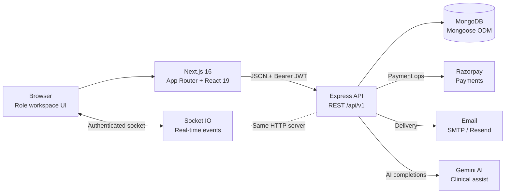

<div align="center">

# HealOS

**An Operating System for Healthcare**

A full-stack hospital management platform built for real clinical workflows — covering every role from patient self-service to emergency trauma care.

[](https://www.typescriptlang.org/)
[](https://nextjs.org/)
[](https://nodejs.org/)
[](https://mongoosejs.com/)
[](https://socket.io/)
[](https://turbo.build/)

</div>

---

## What is HealOS?

HealOS is a production-grade hospital information system that unifies every operational layer of a modern hospital into a single, cohesive platform. Rather than stitching together isolated modules, HealOS provides one coherent system where patient admissions, diagnostics, prescriptions, billing, and clinical documentation all share a live data backbone.

**Nine distinct role workspaces. One platform.**

| Role                    | Workspace           | Key workflows                                                           |
| ----------------------- | ------------------- | ----------------------------------------------------------------------- |
| 🏥 **Patient**          | Self-service portal | Book appointments, view records, pay bills, chat                        |
| 🛎 **Receptionist**      | Front desk          | Walk-in registration, appointment scheduling, billing                   |
| 👨‍⚕️ **Doctor**           | Clinical workspace  | Patient rounds, consultations, orders, e-prescriptions, notes           |
| 👩‍⚕️ **Nurse**            | Ward station        | eMAR, vitals, wound care, fluid balance, call bells, handover           |
| 💊 **Pharmacist**       | Dispensary          | Prescription queue, inventory dispensing, medication history            |
| 🧪 **Lab Technician**   | LIS                 | Sample collection, auto-analyzers, result validation, critical callback |
| 🩻 **Radiologist**      | PACS/RIS            | Study worklist, DICOM upload, structured reporting, slot booking        |
| 🚨 **Emergency Doctor** | ED Board            | Triage, ESI acuity, resus bay, trauma cases, ambulance inbound          |
| ⚙️ **Admin**            | Control panel       | Staff management, ward config, system monitoring, broadcast             |

---

## System Architecture



This is a **modular monolith** — not microservices. All domain routes share one Express process and one MongoDB connection. This keeps transaction logic, deployment, and debugging simple while maintaining clean module boundaries through explicit route namespacing.

### Request & Auth Flow

```
Client Request
  → Axios (auto-attaches Bearer JWT)
  → Express: security headers, CORS, rate-limits, body parsing
  → verifyToken: decode JWT → reload User → check token version
  → requireRole: enforce RBAC at the route level
  → Controller: validate inputs → enforce domain rules → persist
  → Mongoose → MongoDB
  → JSON response + (optional) Socket.IO broadcast
```

> [!IMPORTANT]
> The client route guard is a UX convenience. **API authorization on the server is the security boundary** — every write endpoint re-checks role and ownership independently.

---

## Repository Layout

```
healos/
├── client/                   Next.js web application (@healos/client)
│   └── src/
│       ├── app/              App Router pages, layouts, Next route handlers
│       ├── components/       Shared UI components + role-specific panels
│       │   ├── admin/        Admin workspace shell + 12 panels
│       │   ├── doctor/       Doctor workspace shell + 9 panels
│       │   ├── emergency/    ED panels
│       │   ├── lab/          LIS panels
│       │   ├── nurse/        Nursing panels
│       │   ├── patient/      Patient portal panels
│       │   ├── pharmacy/     Pharmacy panels
│       │   ├── radiology/    RIS/PACS panels
│       │   └── workspace/    Shared workspace shell (WorkspaceShell)
│       ├── lib/api/          Domain API functions (typed Axios wrappers)
│       ├── lib/socket.ts     Singleton Socket.IO client
│       └── store/            Zustand state (auth, UI)
│
├── server/                   Express API server (@healos/server)
│   └── src/
│       ├── routes/           16 domain routers
│       ├── controllers/      Request handling + domain business logic
│       ├── models/           30+ Mongoose schemas with indexes
│       ├── middleware/       JWT/RBAC, rate-limiting, validation, errors
│       ├── utils/            Audit, billing, mail, report, date helpers
│       ├── sockets/          Socket.IO event handlers
│       └── __tests__/        Jest + Supertest + mongodb-memory-server
│
├── packages/shared/          Shared types, constants, Zod validators (@healos/shared)
├── docker-compose.yml        MongoDB, Redis, and containerized services
├── turbo.json                Turborepo task graph + build cache config
└── package.json              npm workspaces root
```

### API Domain Coverage

| Domain router    | Key responsibilities                                                     |
| ---------------- | ------------------------------------------------------------------------ |
| `/auth`          | JWT auth, refresh, Google OAuth, MFA                                     |
| `/appointments`  | Availability engine, slot booking, cancellation                          |
| `/doctor`        | Consultations, orders, prescriptions, rounds                             |
| `/nurse`         | eMAR, vitals, wounds, fluids, call bells, handover                       |
| `/lab`           | Diagnostic orders, sample tracking, result validation, critical findings |
| `/radiology`     | Imaging orders, DICOM uploads, reporting, slot booking                   |
| `/pharmacy`      | Prescription dispensing, inventory management                            |
| `/reception`     | Walk-in registration, same-day scheduling                                |
| `/patient`       | Self-service portal, medical history, messages                           |
| `/emergency`     | Triage board, ESI, resus, ambulance, major incidents                     |
| `/payment`       | Razorpay integration, invoice management                                 |
| `/admin`         | User management, ward config, system settings                            |
| `/ai`            | Gemini-powered clinical documentation assist                             |
| `/notifications` | Real-time notification delivery                                          |
| `/reports`       | Protected diagnostic report file access                                  |
| `/system`        | Health checks, audit logs                                                |

---

## Technology Stack

| Layer                  | Technology                                          |
| ---------------------- | --------------------------------------------------- |
| **Frontend framework** | Next.js 16, React 19, App Router                    |
| **Styling**            | Tailwind CSS 4, Radix UI primitives                 |
| **Animations**         | Motion (Framer Motion)                              |
| **Icons**              | Lucide React                                        |
| **State**              | Zustand (session/UI), TanStack Query (server state) |
| **Forms**              | React Hook Form + Zod                               |
| **HTTP client**        | Axios with interceptors                             |
| **Real-time**          | Socket.IO (server + client)                         |
| **Backend**            | Node.js 20, Express, TypeScript                     |
| **Database**           | MongoDB, Mongoose ODM                               |
| **Validation**         | Zod (shared + server)                               |
| **Auth**               | JWT (access + refresh), NextAuth.js, Google OAuth   |
| **Payments**           | Razorpay                                            |
| **Email**              | SMTP / Gmail API / Resend                           |
| **AI**                 | Google Gemini API                                   |
| **Teleconsult**        | WebRTC + TURN relay (Metered)                       |
| **Monitoring**         | Sentry (client + server)                            |
| **Build system**       | Turborepo + npm workspaces                          |
| **Testing**            | Jest, Supertest, mongodb-memory-server, Cypress     |
| **CI**                 | GitHub Actions                                      |

---

## Quick Start

### Prerequisites

- **Node.js 20+** and **npm 10+**
- **MongoDB** — local service or a MongoDB Atlas URI
- Docker (optional, for containerized local stack)

### 1. Install

```bash
git clone https://github.com/Zuhaib-dev/healos.git
cd healos
npm ci
```

### 2. Configure

```bash
cp .env.example .env
```

Edit `.env` with your values. At minimum set `MONGODB_URI` and `JWT_SECRET`. For the client, create `client/.env.local`:

```env
NEXT_PUBLIC_API_URL=http://localhost:5001/api/v1
NEXT_PUBLIC_APP_URL=http://localhost:3000
```

### 3. Start MongoDB

```bash
# Option A — Docker (recommended for local dev)
docker compose up -d mongodb

# Option B — Start your local mongod
mongod
```

### 4. Run

```bash
# Start both client and server together
npm run dev

# Or separately
npm run dev:client    # → http://localhost:3000
npm run dev:server    # → http://localhost:5001
```

> The API health endpoint: `GET http://localhost:5001/health`  
> All REST routes: `http://localhost:5001/api/v1/*`

---

## Configuration Reference

> [!CAUTION]
> Never commit real `.env` files. Never use the example JWT secrets in any deployed environment.

| Variable                           | Required  | Purpose                                                 |
| ---------------------------------- | --------- | ------------------------------------------------------- |
| `MONGODB_URI`                      | ✅        | MongoDB connection string                               |
| `JWT_SECRET`                       | ✅        | Access token signing key (use a 64+ char random string) |
| `JWT_REFRESH_SECRET`               | ✅        | Refresh token signing key                               |
| `AUTH_SYNC_SECRET`                 | ✅ prod   | Required by production env validation                   |
| `PORT`                             | —         | API listen port (default: `5001`)                       |
| `CLIENT_URL`                       | —         | Allowed browser origin for CORS                         |
| `NEXT_PUBLIC_API_URL`              | ✅ client | API base URL embedded in Next.js build                  |
| `RAZORPAY_KEY_ID` / `_SECRET`      | optional  | Payment integration                                     |
| `SMTP_*` / `RESEND_API_KEY`        | optional  | Email delivery                                          |
| `AUTH_GOOGLE_ID` / `_SECRET`       | optional  | Google OAuth                                            |
| `GEMINI_API_KEY`                   | optional  | AI clinical documentation                               |
| `IMAGEKIT_*`                       | optional  | Media storage for reports                               |
| `NEXT_PUBLIC_TURN_*` / `METERED_*` | optional  | TURN relay for teleconsultation                         |

> [!TIP]
> `NEXT_PUBLIC_*` variables are embedded in the client bundle **at build time**. Set them before running `next build` for production.

---

## Development Commands

```bash
# Run everything (client + server + shared watch)
npm run dev

# Individual workspaces
npm run dev:client
npm run dev:server

# Quality checks (run against all workspaces via Turborepo)
npm run typecheck        # tsc --noEmit across all packages
npm run lint             # ESLint across all packages
npm run format:check     # Prettier format check

# Fix and format
npm run lint:fix
npm run format           # Prettier auto-fix

# Build
npm run build            # Full production build
npm run build:client
npm run build:server

# Test (backend only)
npm run test -w @healos/server

# Docker services
npm run services:up      # Start all Docker services
npm run services:down

# Target a specific workspace
npm run typecheck -w @healos/server
npm run lint -w @healos/client
```

---

## Domain Logic Highlights

### Appointment Availability Engine

The server validates doctor eligibility, working hours, slot alignment, duration, and remaining daily capacity — computing available intervals from the doctor's configured schedule and comparing against persisted appointments. Walk-in bookings at reception enforce same-day, not-in-the-past rules through the same server-side logic.

### Emergency Triage Board

Active ED cases sort by ESI acuity then arrival time. The pending-work endpoint aggregates case, diagnostic order, consultation, and pharmacy state over a bounded recent window. Result details are blocked until report verification completes.

### Diagnostic & Medication Lifecycle

Diagnostic orders and reports are separate linked records with explicit lifecycle states (`PENDING` → `COLLECTED` → `RESULTED` → `VERIFIED`). Prescriptions, pharmacy dispensing sales, and nurse MAR dose events represent different stages and are stored as distinct records.

### Real-time Events

Socket.IO runs on the same HTTP server as Express. The server validates the JWT cookie at connection time and validates room-join requests for user and role rooms. Controllers emit targeted events after writes; clients refetch authoritative API state after receiving them. The database is always the source of truth.

---

## Security & Clinical Data Notes

> [!WARNING]
> This is a software system, not a substitute for clinical governance, local privacy review, or emergency protocols.

- **Server-side authorization is the boundary.** Client route guards are UX only; every API endpoint enforces its own role and ownership checks.
- Keep secrets, production patient data, and clinical records out of source control, logs, screenshots, and test fixtures.
- Diagnostic report contents have workflow-specific verification rules — preserve access restrictions when adding readers or export paths.
- All clinical and audit actions are attributed to the authenticated user and persisted in domain records.
- RBAC is enforced at the route level (`requireRole` middleware); broad role access alone does not authorize all operations — controllers enforce additional domain constraints.

---

## Documentation

| Document                                                   | Description                                              |
| ---------------------------------------------------------- | -------------------------------------------------------- |
| [`client/README.md`](./client/README.md)                   | Frontend architecture, source map, component conventions |
| [`server/README.md`](./server/README.md)                   | API architecture, models, algorithms, deployment         |
| [`packages/shared/README.md`](./packages/shared/README.md) | Shared types, validators, usage                          |
| [`.env.example`](./.env.example)                           | Full environment variable reference                      |

---

## Author

**Zuhaib Rashid** — Full Stack Developer & Healthcare Systems Architect  
UI/UX Engineering · Real-time Systems · Autonomous Agent Protocols

[GitHub](https://github.com/Zuhaib-dev) · [Portfolio](https://zuhaibrashid.com/) · [LinkedIn](https://www.linkedin.com/in/zuhaib-rashid-661345318/) · [X / Twitter](https://x.com/xuhaib_x9)
