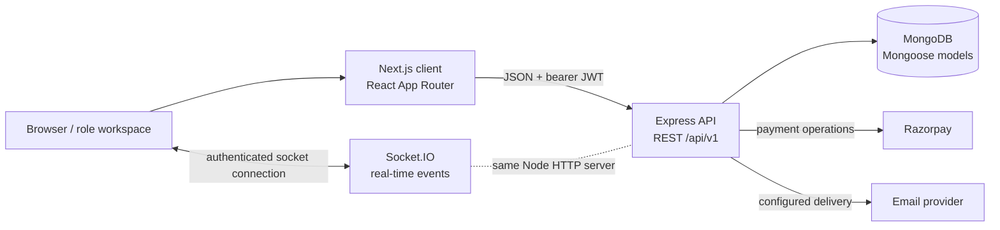

# HealOS

HealOS is a hospital operations and patient-care web application. It brings patient access, reception, clinical workspaces, diagnostics, pharmacy, billing, administration, and emergency-department workflows into one system.

This repository is an **npm-workspaces monorepo** orchestrated by Turborepo. The browser application and API are separate deployable services; shared TypeScript utilities live in a third workspace. The backend is a modular Express application backed by MongoDB, rather than a collection of independently deployed microservices.

## Contents

- [System architecture](#system-architecture)
- [Workspaces](#workspaces)
- [Technology stack](#technology-stack)
- [Workflows and algorithms](#workflows-and-algorithms)
- [Run locally](#run-locally)
- [Configuration](#configuration)
- [Quality checks](#quality-checks)
- [Security and clinical-data notes](#security-and-clinical-data-notes)
- [Further documentation](#further-documentation)

## System architecture



The Next.js app serves the user interface and a small set of Next route handlers (developer/API surfaces, auth integration, and related endpoints). The Express server owns the main `/api/v1` REST API, authentication and role checks, domain workflows, persistence, and the Socket.IO server. Mongoose schemas define persisted domain records and database indexes. Socket events complement API reads and writes; the database remains the source of truth.

This is a **modular monolith**: routes are grouped by domain (`/auth`, `/appointments`, `/doctor`, `/nurse`, `/lab`, `/radiology`, `/pharmacy`, `/reception`, `/emergency`, `/admin`, and others), while controllers and models run in one API process and share one MongoDB connection. This keeps deployment and transactions straightforward while preserving clear module boundaries.

### Request and authorization path

1. A user signs in through the client and receives a backend JWT.
2. The Axios API client sends that token as a bearer credential.
3. Express verifies the token, reloads the user, checks the token version, and attaches the current user to the request.
4. Route middleware checks the user role; controllers validate inputs and enforce workflow rules before changing records.
5. The API returns JSON. When appropriate, the server emits a Socket.IO event so subscribed workspaces can refresh.

The client route guard improves navigation and user experience. API authorization is enforced independently on the server and is the security boundary.

## Workspaces

```text
.
├── client/                 Next.js web application
│   └── src/
│       ├── app/            App Router pages and route handlers
│       ├── components/     Shared UI and role-specific panels
│       ├── lib/            API client, Socket.IO client, utilities
│       └── store/          Zustand client state
├── server/                 Express API and Socket.IO server
│   └── src/
│       ├── routes/         URL and role middleware
│       ├── controllers/    Request handling and domain workflows
│       ├── models/         Mongoose schemas and indexes
│       ├── middleware/     Authentication, validation, errors, limits
│       ├── utils/          Date, audit, mail, report and billing helpers
│       └── __tests__/      Jest API tests
├── packages/shared/        Shared constants, types and Zod validators
├── docker-compose.yml      Local MongoDB, Redis, API and web services
├── turbo.json              Workspace task graph and build cache settings
└── package.json            npm workspace and root commands
```

### Role workspaces

The current application includes patient, receptionist, doctor, nurse, pharmacist, lab technician, radiologist, emergency doctor, and administrator experiences. The backend user model also has a general `USER` role. Available screens and permissions are not identical across roles; server routes define the actual access rules.

| Area        | Example workflows                                                                                 |
| ----------- | ------------------------------------------------------------------------------------------------- |
| Patient     | Appointment booking, billing, medicines, reports, messages, profile                               |
| Reception   | Patient registration, walk-ins, appointment queue, counter workflows                              |
| Doctor      | Clinic, encounters, clinical notes, orders, results, rounds and handover                          |
| Nurse       | eMAR, observations, fluids, wounds, call bells and handover                                       |
| Diagnostics | Lab accession, collection, analysis and validation; radiology bookings, modalities and reports    |
| Pharmacy    | Prescription queue, dispensing and history                                                        |
| Emergency   | Triage board, clinician worklist, resuscitation, EMS, records, pending work and admission handoff |
| Admin       | Staff approvals, users, roles, patients, wards, billing, supplies, audit and system settings      |

## Technology stack

| Layer                 | Technologies in this repository                                                           |
| --------------------- | ----------------------------------------------------------------------------------------- |
| Language              | TypeScript across the client, server and shared package                                   |
| Web                   | Next.js 16 App Router, React 19, Tailwind CSS 4                                           |
| UI                    | Radix UI primitives, Lucide icons, Motion, React Hook Form and Zod                        |
| Client state          | Zustand for client/session UI state; TanStack Query is installed for server-state use     |
| API                   | Node.js 20+, Express 5, REST JSON endpoints                                               |
| Persistence           | MongoDB 7-compatible deployment, Mongoose 8                                               |
| Real time             | Socket.IO 4                                                                               |
| Monorepo              | npm workspaces, Turborepo 2                                                               |
| Validation / security | Zod, JWT, bcryptjs, Helmet, CORS and express-rate-limit                                   |
| Monitoring            | Sentry packages and instrumentation                                                       |
| Payments / email      | Razorpay integration; configurable SMTP, Gmail API or Resend delivery paths               |
| Checks                | TypeScript, ESLint, Prettier, Jest, Supertest; Cypress is included in client dependencies |

Redis is included in the local Docker Compose topology and `REDIS_URL` appears in configuration, but the current server code does not use a Redis client for application caching or Socket.IO pub/sub. Do not assume Redis-backed caching, queues, or horizontal Socket.IO scaling are active features.

## Workflows and algorithms

### Appointment capacity and booking

The API derives bookable times from a doctor's configured clinic days, booking hours, slot duration, and daily patient limit. It counts existing appointments for the doctor and date, removes already-used times, and reports both remaining daily capacity and available times. A partial unique index prevents two non-cancelled appointments from taking the same doctor/date/time slot while allowing a cancelled slot to be reused. Booking requests are revalidated by the server so stale client availability cannot be treated as authoritative. Reception walk-in bookings are checked against today's schedule and past times.

### Emergency department prioritization and records

The live ED board sorts by ESI acuity (lower ESI number first) and arrival time. ED records are case-based and retain the visit lifecycle and links to encounters, observations, diagnostics, medication administrations, pharmacy activity, and admission data. The pending-work view derives tasks from saved records, including unresolved work after discharge; it does not manufacture patient accounts or scheduled nursing doses.

### Diagnostic and medication workflows

Clinician encounters can create diagnostic orders and prescriptions. Orders move through persisted statuses and reports have an explicit verification state; the ED record view only displays clinical report content after verification. Pharmacy sales move through payment and dispensing statuses. Emergency medication administration events separately record whether a prescribed medicine was given, held, or refused.

### Pagination and query shape

List endpoints use bounded page/limit parameters where implemented. The shared package provides pagination defaults and validators, but endpoint behavior is domain-specific. For large collections, prefer database filtering, indexed sort keys and bounded pages over loading a complete collection into the client.

## Run locally

### Prerequisites

- Node.js 20 or newer and npm 10 or newer
- MongoDB (local service or a MongoDB URI)
- Optional integration credentials for payments, email, Google sign-in, AI, or external file services
- Docker Compose if you want to run the repository's containerized local services

### Install and configure

```bash
npm ci
cp .env.example .env
```

Edit `.env` with local values. Never use the example JWT secrets or placeholder provider credentials in a deployed environment. The API loads repository-root `.env` and also supports `server/.env`. For Next.js public variables, create `client/.env.local` and set at least:

```env
NEXT_PUBLIC_API_URL=http://localhost:5001/api/v1
NEXT_PUBLIC_APP_URL=http://localhost:3000
```

Start MongoDB locally, or use Compose for the database while running the app with the workspace scripts:

```bash
docker compose up -d mongodb
```

Then start the workspaces:

```bash
npm run dev
```

The web app is served on `http://localhost:3000`; the API is served on `http://localhost:5001`, with REST routes under `/api/v1` and a health endpoint at `/health`. Turborepo's `dev` task is persistent and starts the workspace dev tasks together.

Useful focused commands:

```bash
npm run dev:client
npm run dev:server
npm run build
npm run typecheck
npm run lint
npm run format:check
```

Run a workspace command from the root with npm's workspace selector, for example `npm run typecheck -w @healos/server`.

## Configuration

The canonical list of supported variables and safe local placeholders is [.env.example](./.env.example). Important settings include:

| Variable                                              | Purpose                                                                |
| ----------------------------------------------------- | ---------------------------------------------------------------------- |
| `MONGODB_URI`                                         | MongoDB connection used by the API                                     |
| `PORT`, `CLIENT_URL`, `NODE_ENV`                      | API runtime and allowed client origin                                  |
| `JWT_SECRET`, `JWT_REFRESH_SECRET`                    | Token signing; use long, unique secrets in production                  |
| `AUTH_SYNC_SECRET`                                    | Required by production environment validation for auth synchronization |
| `NEXT_PUBLIC_API_URL`                                 | Client-side API base URL                                               |
| `RAZORPAY_KEY_ID`, `RAZORPAY_KEY_SECRET`              | Optional payment integration                                           |
| `SMTP_*`, `GMAIL_*`, `RESEND_API_KEY`                 | Optional email delivery configuration                                  |
| `AUTH_GOOGLE_ID`, `AUTH_GOOGLE_SECRET`, `AUTH_SECRET` | Optional client authentication provider settings                       |
| `GEMINI_API_KEY`, `IMAGEKIT_*`, `NEXT_PUBLIC_TURN_*`  | Optional AI, media, and teleconsultation-related configuration         |

Keep server secrets out of `NEXT_PUBLIC_*` variables. The `NEXT_PUBLIC_` prefix makes a value available to browser code.

## Quality checks

The repository CI workflow runs install, lint, typecheck, backend Jest tests, and monorepo builds. Backend tests live in `server/src/__tests__` and use Jest, Supertest, and an in-memory MongoDB test setup.

```bash
npm run lint
npm run typecheck
npm run build
npm run test -w @healos/server
```

## Security and clinical-data notes

- Keep secrets and production patient data out of source control, screenshots, logs, and sample fixtures.
- Server controllers and role middleware are authoritative for access and state changes; a hidden UI control is not authorization.
- Diagnostic report contents may have workflow-specific verification restrictions. Preserve those checks when adding readers or exports.
- Audit and clinical actions should remain attributable to the authenticated user and persisted in their domain records.
- This repository provides software workflows; it does not replace local clinical governance, privacy review, or emergency protocols.

## Further documentation

- [Client architecture and development](./client/README.md)
- [API, persistence, and server development](./server/README.md)
- [Shared workspace package](./packages/shared/README.md)
- [License](./LICENSE)
